# RiskGuard — Entity Relationship Diagram

> Generated in Phase 1. Tracks the full data model used by RiskGuard.
>
> Money fields are `Decimal` (PROJECT_RULES.md rule #1) — never Float.
> Every domain entity is scoped by `userId` (rule #3) — multi-tenant isolation.

## Visual ERD (Mermaid)

```mermaid
erDiagram
    User ||--o{ Account : "Auth.js OAuth"
    User ||--o{ Authenticator : "Auth.js WebAuthn"
    User ||--o{ TradingAccount : "owns"
    User ||--o{ Strategy : "owns"
    User ||--o{ Trade : "places"
    User ||--o{ RiskProfile : "configures"
    User ||--o{ StakingPlan : "saves"
    User ||--o{ TradingSession : "opens"
    User ||--o{ Goal : "sets"
    User ||--o{ Lockout : "subject to"
    User ||--o{ Notification : "receives"
    User ||--o{ AuditLog : "audited"

    TradingAccount ||--o{ Transaction : "cash flow"
    TradingAccount ||--o{ Trade : "executed on"
    TradingAccount ||--o{ RiskProfile : "per-account rules"
    TradingAccount ||--o{ TradingSession : "hosted by"

    Strategy ||--o{ Trade : "tagged with"

    User {
        string id PK
        string name
        string email UK
        datetime emailVerified
        string passwordHash
        string image
        string timezone "default UTC"
        string baseCurrency "default USD"
        datetime createdAt
        datetime updatedAt
    }

    Account {
        string id PK
        string userId FK
        string type
        string provider
        string providerAccountId
        string refresh_token
        string access_token
        int expires_at
        string token_type
        string scope
        string id_token
        string session_state
    }

    Authenticator {
        string credentialID PK
        string userId FK
        string providerAccountId
        string credentialPublicKey
        int counter
        string credentialDeviceType
        boolean credentialBackedUp
        string transports
    }

    TradingAccount {
        string id PK
        string userId FK
        string name
        string broker
        string currency "default USD"
        enum type "DEMO | REAL"
        decimal startingBalance
        decimal currentBalance "derived in Phase 4"
        boolean isArchived
        datetime createdAt
        datetime updatedAt
    }

    Transaction {
        string id PK
        string tradingAccountId FK
        enum type "DEPOSIT | WITHDRAWAL | BONUS | ADJUSTMENT"
        decimal amount
        string note
        datetime occurredAt
        datetime createdAt
        datetime updatedAt
    }

    Strategy {
        string id PK
        string userId FK
        string name "unique per user"
        string description
        string color "hex"
        boolean isActive
        datetime createdAt
        datetime updatedAt
    }

    Trade {
        string id PK
        string userId FK
        string tradingAccountId FK
        string strategyId FK "nullable"
        string asset
        enum direction "CALL | PUT"
        decimal stake
        decimal payoutPercent
        int expiryMinutes
        datetime openedAt
        datetime closedAt "nullable"
        enum result "WIN | LOSS | TIE | OPEN"
        decimal profitLoss
        decimal balanceAfter "nullable"
        string timeframe
        string setupNotes
        enum emotion "CALM | CONFIDENT | FEARFUL | GREEDY | REVENGE | TIRED | BORED"
        boolean followedPlan
        string screenshotUrl "nullable"
        json tags "JSON array"
        datetime createdAt
        datetime updatedAt
    }

    RiskProfile {
        string id PK
        string userId FK
        string tradingAccountId FK "nullable (null = global)"
        decimal riskPerTradePercent "default 2"
        decimal maxDailyLossPercent "default 6"
        decimal maxDailyLossAmount "nullable"
        decimal dailyProfitTargetPercent "nullable"
        int maxTradesPerDay "default 10"
        int maxConsecutiveLosses "default 3"
        int cooldownMinutes "default 15"
        int maxOpenTrades "default 3"
        decimal weeklyLossLimitPercent "nullable"
        boolean lockoutEnabled "default true"
        datetime createdAt
        datetime updatedAt
    }

    StakingPlan {
        string id PK
        string userId FK
        string name "unique per user"
        enum method "FIXED_AMOUNT | FIXED_PERCENT | COMPOUNDING | ANTI_MARTINGALE | FIBONACCI | MARTINGALE | KELLY_FRACTION | CUSTOM"
        json config "shape depends on method (Phase 8 validates)"
        boolean isDefault
        datetime createdAt
        datetime updatedAt
    }

    TradingSession {
        string id PK
        string userId FK
        string tradingAccountId FK
        datetime startedAt
        datetime endedAt "nullable"
        decimal startBalance
        decimal endBalance "nullable"
        string notes
        enum mood "FOCUSED | CALM | TIRED | FRUSTRATED | CONFIDENT | REVENGEFUL"
        datetime createdAt
        datetime updatedAt
    }

    Goal {
        string id PK
        string userId FK
        enum type "DAILY | WEEKLY | MONTHLY | BALANCE_TARGET"
        decimal targetAmount
        datetime startDate
        datetime endDate
        enum status "ACTIVE | ACHIEVED | MISSED | CANCELLED"
        datetime createdAt
        datetime updatedAt
    }

    Lockout {
        string id PK
        string userId FK
        enum reason "DAILY_LOSS | CONSEC_LOSSES | MAX_TRADES | WEEKLY_LOSS | MANUAL"
        datetime startedAt
        datetime expiresAt "nullable"
        datetime overriddenAt "nullable"
        string overrideReason "nullable"
        datetime createdAt
        datetime updatedAt
    }

    Notification {
        string id PK
        string userId FK
        string type
        string title
        string body
        datetime readAt "nullable"
        datetime createdAt
    }

    AuditLog {
        string id PK
        string userId FK
        string action
        string entity
        string entityId
        json meta
        datetime createdAt
    }
```

## Indexes

| Table          | Index                                  | Purpose                                                       |
| -------------- | -------------------------------------- | ------------------------------------------------------------- |
| TradingAccount | `userId`                               | List user's accounts fast.                                    |
| TradingAccount | `userId, isArchived`                   | Active-account picker.                                        |
| Transaction    | `tradingAccountId, occurredAt`         | Account history (Phase 4).                                    |
| Strategy       | `userId`                               | List user's strategies fast.                                  |
| Strategy       | `userId, name` (unique)                | No duplicate strategy names per user.                         |
| Trade          | `userId, openedAt`                     | Journal listing & equity curve (Phase 5, 6, 9).               |
| Trade          | `tradingAccountId, openedAt`           | Account-scoped equity walk (Phase 4).                         |
| Trade          | `userId, result`                       | Win-rate queries (Phase 6, 9).                                |
| Trade          | `userId, asset`                        | "Win rate by asset" (Phase 9).                                |
| Trade          | `strategyId`                           | Strategy breakdown (Phase 9).                                 |
| RiskProfile    | `userId`                               | Pull user's risk rules.                                       |
| RiskProfile    | `userId, tradingAccountId` (unique)    | One risk profile per (user, account) — null = global default. |
| StakingPlan    | `userId`                               | List user's staking plans.                                    |
| StakingPlan    | `userId, name` (unique)                | No duplicate plan names per user.                             |
| TradingSession | `userId, startedAt`                    | Session history.                                              |
| TradingSession | `tradingAccountId, startedAt`          | Account-scoped session history.                               |
| Goal           | `userId, status`                       | Active goals query.                                           |
| Goal           | `userId, type, startDate`              | Recurring goal lookup by type.                                |
| Lockout        | `userId, expiresAt`                    | "Is there an active lockout?" query (Phase 7).                |
| Lockout        | `userId, reason`                       | Lockout-history report.                                       |
| Notification   | `userId, readAt`                       | Unread count (Phase 12).                                      |
| Notification   | `userId, createdAt`                    | Paginated notification feed.                                  |
| AuditLog       | `userId, createdAt`                    | Audit trail by recency.                                       |
| AuditLog       | `userId, entity, entityId`             | "Show all events for this trade/account."                     |
| Account        | `userId`                               | Auth.js adapter.                                              |
| Account        | `provider, providerAccountId` (unique) | Auth.js adapter.                                              |
| Authenticator  | `userId`                               | Auth.js adapter.                                              |
| Authenticator  | `userId, providerAccountId` (unique)   | Auth.js adapter.                                              |

## Multi-tenant Isolation

Every domain table carries a `userId` column (or reaches one via FK like
`Transaction → TradingAccount.userId`). Per PROJECT_RULES.md rule #3, every
server-side query MUST filter `where: { userId }` (or join via the parent's
`userId`). Phase 13 adds a CI check that statically scans server actions for
this filter on every domain query.

## Money & Percentage Storage

| Field shape    | Prisma type | Production target (Postgres)         |
| -------------- | ----------- | ------------------------------------ |
| Money          | `Decimal`   | `NUMERIC(18, 2)` — added in Phase 14 |
| Percentage     | `Decimal`   | `NUMERIC(7, 4)` — added in Phase 14  |
| Payout percent | `Decimal`   | `NUMERIC(7, 4)` — e.g. `0.8500`      |
| Risk percent   | `Decimal`   | `NUMERIC(7, 4)` — e.g. `0.0200`      |

Dev (SQLite) preserves full Decimal precision via Prisma's serialization layer
even though SQLite stores it as TEXT — round-trip verified in
`scripts/verify-seed.ts`.

## Cascade Rules

| Parent → Child                 | On parent delete | Notes                                        |
| ------------------------------ | ---------------- | -------------------------------------------- |
| User → TradingAccount          | Cascade          | No orphan accounts.                          |
| User → Strategy                | Cascade          |                                              |
| User → Trade                   | Cascade          | Trade history goes with the user.            |
| TradingAccount → Transaction   | Cascade          |                                              |
| TradingAccount → Trade         | Cascade          | Deleting an account removes its trades.      |
| TradingAccount → RiskProfile   | Cascade          | Per-account profile follows the account.     |
| Strategy → Trade               | SetNull          | Deleting a strategy keeps trades, nukes tag. |
| User → Account / Authenticator | Cascade          | Auth.js adapter expectation.                 |
